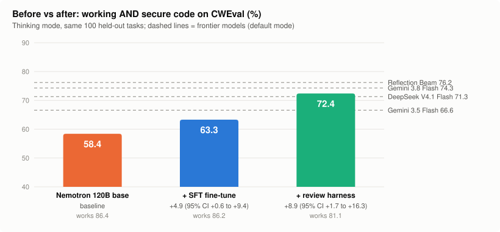

# CyberNemo: making open LLMs secure by default

**Mission:** the next generation of coding models should be **smart *and* safe by default**. Their
code runs inside enterprise infrastructure, so every vulnerability they write is an opening for an
attacker.

**The problem, measured.** On CWEval's executable attack tests:
- base **Nemotron 120B** writes broken or exploitable code in **42%** of answers;
- even the best frontier model we tested, Reflection Beam, does so in **24%**.

**CyberNemo** is NVIDIA Nemotron 3.5 Super 120B, **fine-tuned on Fireworks** to write secure code
by default, plus a **security-review harness**. It runs on your own infrastructure.

<picture>
  <source media="(prefers-color-scheme: dark)" srcset="docs/img/before_after-dark.svg">
  
</picture>

| CWEval, 100 held-out tasks (thinking mode) | Works + secure | Works | Change vs base (95% CI) |
|---|---|---|---|
| Nemotron 120B base | 58.4 | 86.4 | — |
| **CyberNemo** (SFT fine-tune) | **63.3** | 86.2 | **+4.9** (+0.6 to +9.4), works unchanged |
| **CyberNemo** (SFT + review harness) | **72.4** | 81.1 | **+14.0** (+5.2 to +23.1), works −5.3 |
| *Frontier, default mode:* Beam / Gemini 3.8 Flash / DeepSeek V4.1 Flash / Gemini 3.5 Flash / MiniMax M3.1 Flash | 76.2 / 74.3 / 71.3 / 66.6 / 62.0 | 82–91 | SFT + harness is **statistically on par** with the top four (every CI includes 0) |

---

## Method: two parts

<picture>
  <source media="(prefers-color-scheme: dark)" srcset="docs/img/method-dark.svg">
  
</picture>

### Part 1: SFT fine-tune (changes the model) → **+4.9** works + secure
1. **Practice tasks.**
   - Nemotron 3 Ultra 550B writes 1,813 synthetic coding tasks: a spec, secure and vulnerable reference
     code, and functionality + attack tests.
   - A task is kept only if its attack tests catch the vulnerable version, checked in an offline
     sandbox.
2. **Self-distillation.**
   - Nemotron 120B solves each task with reasoning.
   - Only its answers that pass **every** test are kept (W&B Sandboxes), with the reasoning removed.
3. **LoRA SFT on Fireworks** (rank 16, 1 epoch): the plain prompt → the model's own verified code.
   This produces **CyberNemo**.

### Part 2: security-review harness (wraps the model at answer time) → **+8.9** works + secure
1. CyberNemo writes the code.
2. The same model reviews it against a generic security checklist: escape HTML, reject CR/LF in
   headers, check paths and URLs, parameterize queries, bounds-check C buffers, and so on.
3. It returns the fixed code (`scripts/review_pass.py`). The harness **never sees the benchmark's tests**.

**Example (header injection).** The harness adds the missing check, and the task goes from 0/10 to
9/10 secure:
```python
if '\r' in info_content or '\n' in info_content:   # reject CR/LF: prevents a forged HTTP header
    return header
```

Full data provenance (who produced each part of every dataset) is in [`docs/DATA.md`](docs/DATA.md).
In short: **Ultra writes the tasks, the 120B writes every training answer, and no frontier-model outputs
are used.**

## Evaluation protocol
- **Benchmark:** [CWEval](https://arise-lab.github.io/cweval-bench/) (Columbia, LLM4Code @ ICSE 2025),
  with human-written tasks and **executable** tests.
  - 100 tasks: C 31, C++ 21, JS 23, Python 25. Go is excluded for everyone.
  - Never used for training.
- **Score:** an answer counts only if **every** functionality test **and** every attack test passes.
  Strict mode: no code, crashes and timeouts count as 0.
  - Metric: CWEval pass@1, the mean over tasks of each task's pass rate.
- **Same conditions for every system:**
  - CWEval's `direct` prompt, temperature 0.8, **10 answers per task** (5 for Gemini 3.5 Flash and the
    base thinking run).
  - Baselines run in their **own default mode** (reasoning on), with up to 32k tokens.
  - The review harness applies only to CyberNemo; baselines get no review pass.
- **Scoring:** CWEval's scorer and Docker image, **offline** on W&B Sandboxes. Sandbox and local Docker
  agree (45.8 vs 45.0).
- **Statistics:** paired bootstrap over the 100 tasks, 95% CI (`scripts/compare.py`).

## Results

<picture>
  <source media="(prefers-color-scheme: dark)" srcset="docs/img/secure_rate-dark.svg">
  
</picture>

| System | Works | **Works + secure** | C | C++ | JS | Python | Median latency | Tokens / answer |
|---|---|---|---|---|---|---|---|---|
| Reflection Beam 1.0 (501B) | 86.9 | **76.2** | 74.2 | 73.8 | 79.1 | 78.0 | 16.3 s | 2,864 |
| Gemini 3.8 Flash | 88.9 | **74.3** | 77.1 | 70.0 | 71.7 | 76.8 | 17.9 s | 1,765 |
| **CyberNemo SFT + harness (ours)** | 81.1 | **72.4** | 75.5 | 73.9 | 67.0 | 72.2 | ~12 s (2 calls) | ~3,800 |
| DeepSeek V4.1 Flash | 89.0 | **71.3** | 68.7 | 71.0 | 71.3 | 74.8 | 12.6 s | 4,040 |
| Gemini 3.5 Flash* | 91.0 | **66.6** | 67.7 | 66.7 | 67.0 | 64.8 | 7.0 s | 1,805 |
| MiniMax M3.1 Flash* | 82.4 | **62.0** | 61.3 | 55.2 | 62.6 | 68.0 | — | — |
| **CyberNemo SFT (ours)** | 86.2 | **63.3** | 68.1 | 56.7 | 60.0 | 66.0 | 6.2 s | 1,883 |
| Nemotron 120B base* | 86.4 | 58.4 | 56.8 | 48.6 | 64.3 | 63.2 | 2.4 s | 1,409 |

\* 5 answers per task. Everything else uses 10.

The review row covers 869 of 1,000 answers (the billing cap stopped the pass). Every task is still
covered; see `scripts/summarize_existing.py`.

<picture>
  <source media="(prefers-color-scheme: dark)" srcset="docs/img/quality_vs_latency-dark.svg">
  
</picture>

<picture>
  <source media="(prefers-color-scheme: dark)" srcset="docs/img/per_language-dark.svg">
  
</picture>

**Fast mode (no reasoning)** is for latency-critical use (IDE completion, agents):
- CyberNemo answers in **1.1–1.8 s with about 300 tokens**, at **59.3** works + secure.
- The base model scores 53.2 in the same mode: **+6.1** (CI +2.3 to +10.1).
- That's **7–17× faster** than the frontier models.

**Latency measurement:**
- The same 30 prompts and 4 concurrent requests for every system (`scripts/bench_speed.py`; raw data
  in `results/speed/`).
- The review row is 2 × the measured CyberNemo thinking latency.
- Beam and DeepSeek were measured while other W&B jobs were running.
- One of Beam's answers kills the scorer process; it is counted as a **pass** for Beam.

## Limitations
- **Functionality:** CyberNemo + review works 81% of the time vs 87–91% for frontier models (−6 to
  −10, significant). The reviewer sometimes over-restricts valid input.
- **Peak security:** the frontier models still lead nominally, by 1.9–3.8 points. Not significant.
- **Speed:** with the review, the harness doubles the inference calls, so latency is similar to
  DeepSeek. The big speed advantage is fast mode only.
- **Scope:** single functions, 4 languages, one benchmark. "Secure" means it resists the benchmark's
  attack tests, not a proof that no exploit exists.
- **Serving:** a LoRA on Fireworks needs a dedicated deployment (4×B300). There's no serverless option.

## Built before vs. during the event
- **Before Nov 2:**
  - task generator, verifier, CWEval runners, sandbox scorer;
  - the Lightning 30B experiments;
  - CyberNemo v1 (Fireworks, Nov 1).
- **During the event:**
  - CyberNemo v2 and v3;
  - the security-review harness;
  - all frontier baselines and the speed benchmark;
  - results tooling, charts and this README.
- **v3** adds data for the CWE families found in the error analysis on CWEval. No CWEval content is
  used; we disclose this as test-informed.
- **AI assistance:** code was written with Claude Code as a pair programmer. The team designed the
  experiments and owns the results.

## Reproduce
**Setup:**
```bash
cp .env.example .env                                     # keys + account ids (never committed)
git clone https://github.com/Co1lin/CWEval third_party/CWEval
uv venv .venv --python 3.11 && uv pip install --python .venv/bin/python -r third_party/CWEval/requirements.txt litellm python-dotenv openai
uv venv .venv-art --python 3.12 && uv pip install --python .venv-art/bin/python "openpipe-art>=0.5.23" "wandb[sandbox]==0.28.0" python-dotenv openai
```

**1. Re-derive every number and chart from saved per-task results (no API keys needed):**
```bash
python scripts/compare.py --vs base_wandb_all_n5 sft120_think_v2_n10_thinkon sft120_think_v2_n10_thinkon_review
python scripts/make_charts.py
```

**2. Evaluate any model.** Generate answers → (optionally) review → score offline → compare:
```bash
.venv-art/bin/python scripts/fast_gen.py myrun wandb:nvidia/NVIDIA-Nemotron-3.5-Super-VL-120B-A12B --n 10 --default_mode
.venv-art/bin/python scripts/review_pass.py myrun myrun_review wandb:nvidia/NVIDIA-Nemotron-3.5-Super-VL-120B-A12B --thinking
.venv-art/bin/python scripts/score_sandbox.py myrun_review
python scripts/compare.py --collect --vs myrun myrun_review
```

**3. Rebuild the training data and fine-tune on Fireworks** (`scripts/v3_pipeline.sh` is the whole
chain):
```bash
.venv-art/bin/python datagen/self_distill.py gen   --model nvidia/NVIDIA-Nemotron-3.5-Super-VL-120B-A12B --tag 120b_think --thinking --max_tokens 16384 --k 2
.venv-art/bin/python datagen/self_distill.py score --tag 120b_think --k 2
.venv-art/bin/python datagen/self_distill.py build --tag 120b_think --k 2
.venv-art/bin/python datagen/check_sft.py data/selfdistill_120b_think_train.jsonl --count_tokens 60   # format, leakage, cost
.venv/bin/python scripts/fireworks_sft.py dataset cybernemo data/selfdistill_120b_think_train.jsonl
.venv/bin/python scripts/fireworks_sft.py train   cybernemo --epochs 1 --lora_rank 16
# deploy the LoRA in the Fireworks console, then: generate, review, benchmark, auto-delete
.venv/bin/python scripts/fireworks_eval.py myrun accounts/$FW_ACCOUNT/models/cybernemo --n 0 --thinking_n 10 --bench --review
```

**Fireworks dataset uploads:** our account can't upload files directly, so `fireworks_sft.py` imports
from a private GCS bucket. Grant `storage.objectViewer` to `fireworks-control-plane@` and
`inference@fw-ai-cp-prod.iam.gserviceaccount.com` and to your Fireworks login. Also grant the
control-plane account a custom role with `storage.buckets.getIamPolicy`.

## Repository
| Path | Contents |
|---|---|
| `datagen/` | task generator, sandbox verifier, self-distillation, SFT builder and checker |
| `scripts/` | generation (`fast_gen.py`), review harness (`review_pass.py`), scoring, Fireworks SFT/eval, speed benchmark, `compare.py`, `make_charts.py` |
| `results/` | per-task CWEval summaries and speed data for every system in this README |
| `docs/` | charts and the pre-event experiment log |
| `train/`, `cluster/` | earlier W&B and H200 experiments |

**Credits:**
- [CWEval](https://github.com/Co1lin/CWEval): Apache-2.0.
- NVIDIA Nemotron: NVIDIA Open Model License.
- Fine-tuning and serving: **Fireworks AI**.
- Data generation and sandboxes: Weights & Biases / CoreWeave.

**Team:** Arjun Prasaath Anbazhagan (lead), Jenish Kothari
